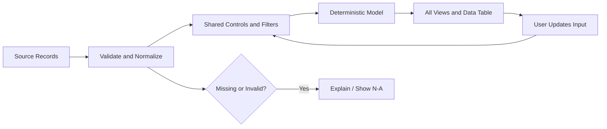

# Interactivity, Data Contracts & State

[← Prompting](05-prompt-engineering.md) · [Accessibility & QA →](07-accessibility-and-qa.md)

## Minimum data contract

| Field | Meaning | Example |
|---|---|---|
| `metric_name` | Exact measure definition | Gross margin |
| `value` | Numeric/text data with semantics | `0.31` |
| `unit` | Prevent scale mistakes | ratio, %, IDR million |
| `period` | Comparable time grain | `2026-Q2` |
| `source` | Origin and permitted usage | Provided CSV |
| `source_date` | Freshness cutoff | `2026-10-20` |
| `status` | Observed, reported, scenario, or missing | `actual` |
| `assumption` | Changeable what-if driver | `delay_months=3` |

Never manufacture rows, exchange rates, addresses or external benchmarks. Show unavailable fields explicitly rather than silently replacing them with zero.

## Conceptual state cycle

This is a **design model**, not a claim about ChatGPT's internal runtime.

## Multi-view state consistency

For a calculator + timeline + scenario sensitivity table, define **one canonical analysis state**. Every view consumes a consistent snapshot, never independent ad hoc defaults.

| State dimension | Example invariant | Failure to reject |
|---|---|---|
| Dataset/version | Same file hash or declared source date | Table and chart use different datasets |
| Currency/base unit | IDR million throughout, convert before aggregation | Calculator in IDR; graph in IDR billion with no label |
| Period/timezone | WIB (`Asia/Jakarta`), calendar month ends | Timeline uses UTC cutoff while table uses local date |
| Scenario ID | Base, downside, severe identified by one selected state | Chart shows downside while KPI shows base |
| Filters | Region, project and selected cohort applied to all views | KPI ignores region selection |
| Formula version | Cash-flow model and discount conventions consistent | XIRR differs without explanation |
| Missingness | Zero, unknown and N/A remain distinguishable | A missing payment becomes zero collected |

**Acceptance protocol:** (1) record baseline state and expected totals, (2) change one control, (3) verify the impacted KPI, chart, table and timeline update coherently, (4) reset and reproduce baseline, (5) test fast switching and empty states. If interaction cannot guarantee shared state, simplify to one primary visualization with a verified supporting table.

## Numeric and time conventions

- Financial models: specify currency, principal, cash-flow dates, fees, taxes, compounding, annualization, discount rate and rounding convention.
- **IRR/XIRR:** require signed cash flows and appropriate timing; a promised coupon is not an investor's independently verified return.
- Operational data: state record grain, unique key, eligible denominator and deduplication rules.
- Dates: distinguish transaction timestamp, event date, reporting cutoff, and user's timezone.
- Use full calculation precision internally; round only for display.

## Edge-case matrix

| Condition | Expected behavior |
|---|---|
| Missing/NaN input | Explain missing values, no fabricated plot |
| Forbidden negative values | Validate/reject field |
| All points filtered out | Clear empty state and reset |
| Mixed currency or scale | Require justified conversion |
| Large dataset | Declare binning, sampling or aggregation |
| Missing period | Flag gaps; do not silently forward-fill |
| Single scenario parameter change | Preserve all other parameters |
| Divergent views | Flag mismatch and block decision-use until reconciled |

## Persistence boundary

Changing a UI control does not prove the result was stored in a database. A prototype approval badge does not enact any approval, payment, order or binding governance status. For persistent state or side effects, design authenticated backend services and auditable permissions separately.
